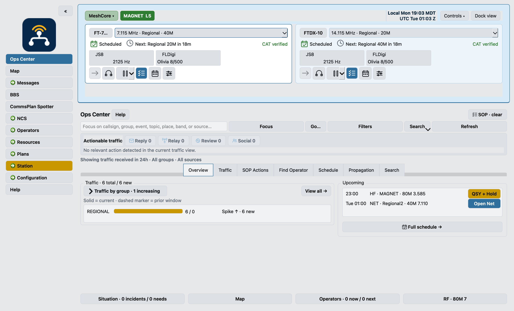
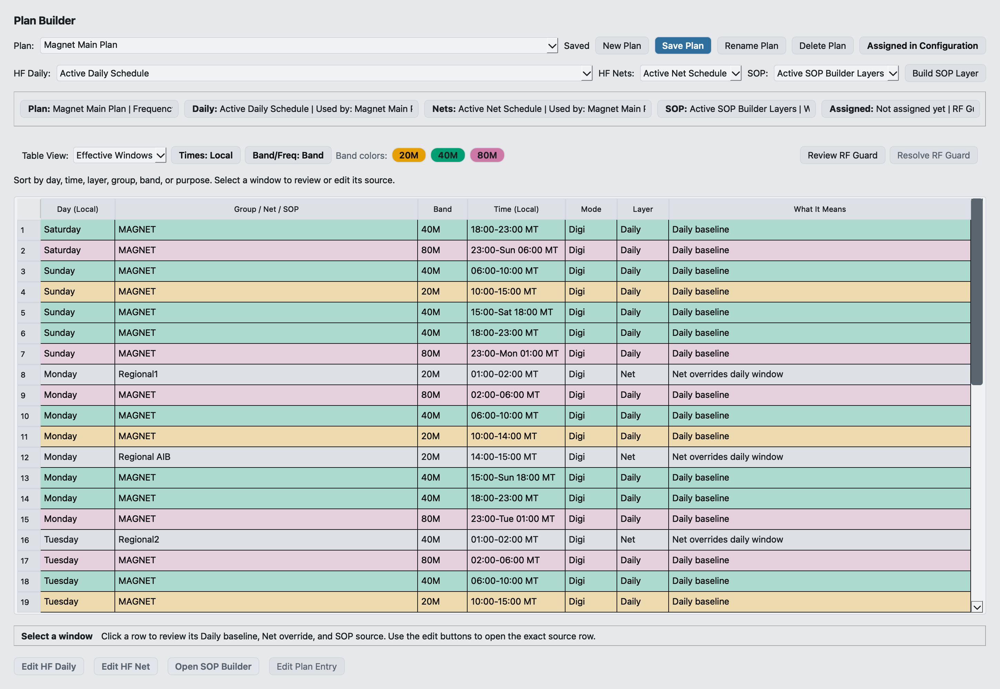
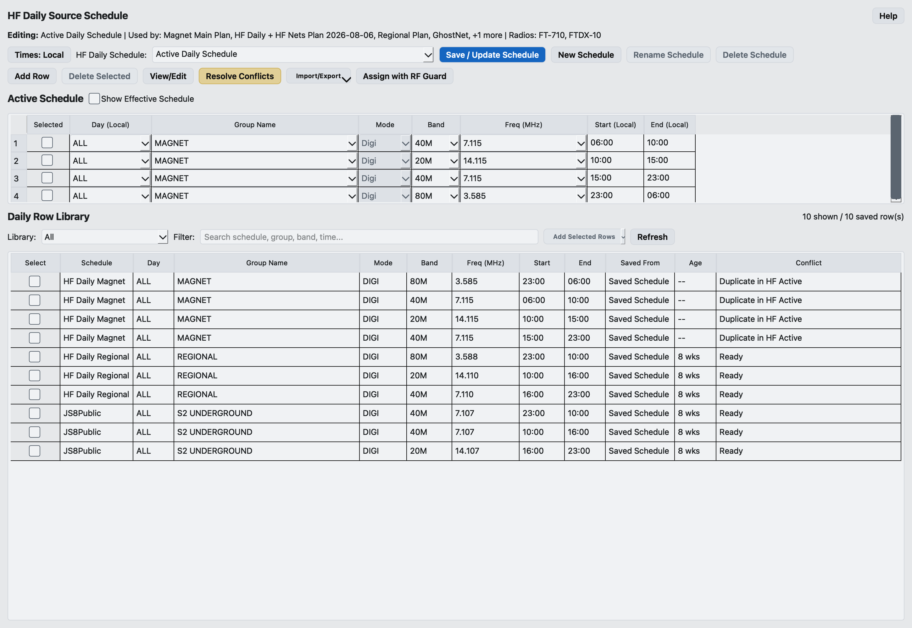
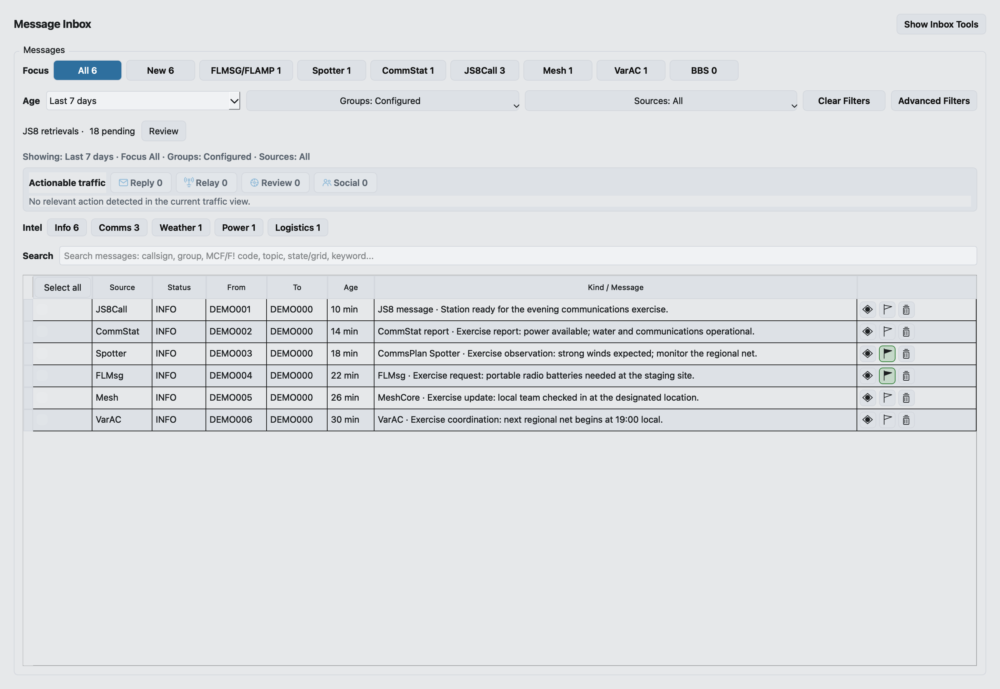
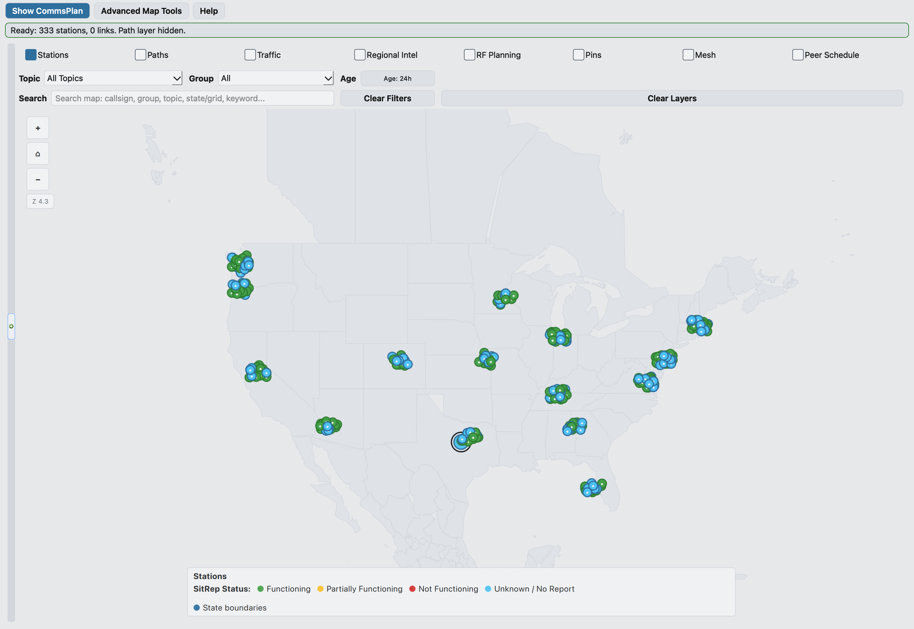

<p align="center">
  
</p>

# CommsPlan 2.0.5 — Release Candidate

> This is a non-publishing candidate for isolated qualification, not a production
> release. Public production downloads remain FreqInOut 2.0.4. Candidate packages,
> upgrades, uninstall and recovery are still under test. Keep your working station
> and verified backups. See [migration preparation](docs/CommsPlan-migration.md).

### A coordinated operations console for HF digital stations

CommsPlan brings radio configuration, companion applications, schedules,
message intelligence, traffic review, operational awareness, and station
services into one desktop workspace. Version 2.0 makes multi-radio operation
the standard architecture while keeping a one-radio station simple and fully
supported.

CommsPlan does not replace FLRig, FLDigi, FLMsg, FLAmp, JS8Call, VarAC, VARA,
MeshCore, or Meshtastic. It coordinates those independently useful applications
as one coherent station while preserving their own profiles, records, and
protocol-specific controls.

<p align="center">
  
</p>

*Screenshots show a demonstration station with scrambled identities and fictional
exercise messages. Radio readbacks and green Mesh connection status are simulated
for illustration; no live radio or Mesh connection was used. Detail images show
the individual workspaces.*

## One operating picture for the station

CommsPlan connects the station's setup and operating surfaces so the operator
can move from configuration to a live, explainable operating picture:

- **Main and Radios:** define the station identity, operating groups, policies,
  and software once, then give each radio its own application identity, profile,
  ports, paths, message locations, plan assignment, and launch behavior.
- **Message Intelligence:** normalize supported traffic into source-aware
  summaries, topics, locations, status, and attention cues while preserving the
  original message and its receive or import provenance.
- **CommsPlan Spotter (FIO Spotter) and CommStat:** use CommsPlan's built-in FIO Spotter service to
  review Spotter forms and CommStat reports in the same station evidence model,
  with source and transport context kept visible.
  CommStat-derived or Internet-assisted evidence is not presented as proof that
  the selected radio heard it locally.
- **Plans and scheduling:** build reusable Frequency Plans from HF Daily, HF
  Nets, and SOP layers, assign them to radios, and review the resulting windows
  in Ops Center before guarded scheduler actions occur.
- **Messages and Compose:** review JS8Call, Spotter, CommStat, FLMsg, FLAmp,
  VarAC, Mesh, and BBS traffic in one inbox, then stage supported outbound forms,
  files, messages, and local-mesh traffic from one workspace.
- **Map and mesh:** use the offline map for station, regional, path, traffic,
  schedule, and mesh-node context. MeshCore and Meshtastic are station services
  that can contribute received text and positions without becoming HF radio
  profiles.
- **Station services:** monitor readiness and launch behavior per radio, and
  manage Net Control, Spotter watches and Expect policies, VarAC BBS
  publication, and FLAmp queues with explicit access and safety controls.

## HF Digital Tri-Mode

HF Digital Tri-Mode combines three complementary families of amateur-radio
software:

- **Fast Light:** FLRig provides radio control, FLDigi supports digital-mode
  operation, and FLMsg and FLAmp support structured messages and file transfer.
- **JS8Call:** provides weak-signal keyboard messaging, store-and-forward
  capabilities, and relay communication using JS8.
- **VarAC and VARA:** provide chat, messaging, file transfer, BBS, and related
  services.

CommsPlan helps bring these independently useful applications together as a
coordinated station. It can discover and configure application instances,
maintain separate identities for multiple radios, manage paths and endpoints,
monitor readiness, control application launching, associate schedules with
radios, and collect supported traffic into a common station message library.

For multi-radio stations, CommsPlan keeps each radio's application profiles,
ports, message locations, and launch identities distinct. Station-level
services such as CommsPlan Spotter, FLAmp Q, CommStat, and the CommsPlan BBS can
then work with received traffic according to the operator's configured access
and publication policies.

## Station setup: Main, Radios, and Local Mesh

Main configuration holds station-wide identity, operating groups, access
policies, and defaults. Each configured radio then has an explicit identity,
operating-model and Frequency Plan assignment, application configuration,
connections, and launch policy. Guided Add Radio and Software Administration
use the same saved software identities, so review and runtime behavior stay
aligned.

Launch Control distinguishes health monitoring, launch-at-startup policy, and
manual start actions. CommsPlan attributes process and endpoint readiness to the
correct radio instance before deciding that an application is already running.

Local Mesh connects supported MeshCore and Meshtastic devices at the station
level. Received text and node positions can enter the canonical inbox and map;
qualified connections can use the guarded Local Mesh Compose path when outbound
permission is explicitly enabled. Mesh transport state remains separate from
HF radio identity and schedule assignment.

## Plan Builder and scheduling

Plan Builder combines saved HF Daily schedules, HF Net rows, and SOP condition
layers into a named Frequency Plan. Assignments remain explicit, so operators
can see which radio and plan own a scheduled window. Ops Center shows the live
effective context, while the scheduler applies guarded changes with visible
holds, busy deferral, and manual-control boundaries.





## Message Intelligence, Messages, and Compose

CommsPlan projects supported traffic into one canonical station message library
with stable source identity and external references. Message Intelligence adds
message summaries, topics, locations, status and attention cues, and suggested
routing context so operators can scan the inbox and map without losing the original
message, source, radio, endpoint, or receive-path evidence.

The library can include JS8Call, built-in FIO Spotter traffic, reviewed
JS8Spotter imports, CommStat, FLMsg, FLAmp, VarAC, BBS, MeshCore, and
Meshtastic traffic. CommStat artifacts and
JS8-delivered CommStat reports retain their status and brevity context when
available; source labels preserve the difference between RF, Internet-assisted,
and imported evidence. Compose stages only the capabilities supported by the
selected application and transport, including FLMsg/FLAmp, JS8Call, CommStat
RF, Spotter forms, VarAC files, and qualified Local Mesh sends.



## CommsPlan Spotter (FIO Spotter) and automation

CommsPlan includes a built-in **CommsPlan Spotter** workspace—the FIO Spotter
service—for station-wide watches, JS8 Expect responses, access policies, forms,
and reviewed imports.
Actual received traffic stays in Messages, where source-neutral actions can send
it to the Map, an operator record, a reply workflow, or a saved watch.

The optional external **External Spotter/JS8Spotter** companion keeps its own
installation, profile, and application identity. CommsPlan can launch a
configured external companion or import its selected data explicitly; it does
not rename that companion to CommsPlan Spotter. Built-in responses and forms
use the existing guarded JS8Call path, with the selected radio, target, policy,
and payload visible before a send.

## Offline operational map

The map uses bundled geography and local station data, so it remains useful
without an Internet tile service, account, or API key. It combines known
stations, regions, paths, schedules, peer activity, Spotter and CommStat
evidence, message-derived context, and MeshCore/Meshtastic nodes or positions.
Layers and inspectors keep the source and age of evidence visible; the map is
decision support rather than a guarantee of current propagation or delivery.



## Testing this candidate

Use branch `release/public-2.0.5-candidate` and a separate profile. These commands
create a new test station; they do not migrate your existing station. Do not
select a working station profile until its backup and upgrade procedure have
been reviewed. Candidate packages are available from successful **Build and
Publish Release** candidate runs under GitHub Actions, not from a new GitHub
Release. Despite its name, that workflow does not publish a release for candidate
branches. Verify the exact commit and adjacent SHA-256 before using an artifact.

Windows source test (PowerShell, Python 3.11):

```powershell
git clone --branch release/public-2.0.5-candidate https://github.com/N1MAG/FreqInOut.git "$HOME\CommsPlan-candidate"
Set-Location "$HOME\CommsPlan-candidate"
$env:FREQINOUT_CONFIG_DIR = "$env:LOCALAPPDATA\CommsPlan-Candidate-Test"
py -3.11 install_freqinout.py
.\start-commsplan.cmd
```

Linux/macOS source test (Python 3.11):

```sh
git clone --branch release/public-2.0.5-candidate https://github.com/N1MAG/FreqInOut.git "$HOME/CommsPlan-candidate"
cd "$HOME/CommsPlan-candidate"
export FREQINOUT_CONFIG_DIR="$HOME/.commsplan-candidate-test"
python3.11 install_freqinout.py
./start-commsplan.sh
```

The explicit profile override applies to this shell and child processes. Close
this shell after testing. Do not run the candidate and production station
concurrently against shared companion profiles or radio endpoints.

Candidate package basenames:

- Windows: `CommsPlan-2.0.5-windows-x86_64-setup-unsigned.exe`
- Linux: `CommsPlan-2.0.5-linux-amd64.deb`
- Apple Silicon: `CommsPlan-2.0.5-macos-arm64-unsigned.dmg`
- Intel macOS: `CommsPlan-2.0.5-macos-x86_64-unsigned.dmg`

Unsigned labeling describes operating-system trust, not qualification. The
existing FreqInOut repository URL remains valid during pre-rename testing. The
production-download and source-install sections below describe the existing
2.0.4 release; do not use them to select this candidate accidentally.

## Supported systems

| Platform | CommsPlan 2.0 support |
|---|---|
| Linux amd64 | GitHub Release `.deb`, source install, and guided installer |
| Windows 10/11 x86-64 | GitHub Release installer and source install |
| macOS Intel and Apple Silicon | GitHub Release disk images and source install |

Python **3.10 through 3.13** is accepted by CommsPlan; Python 3.11 is the tested and
recommended release interpreter. Companion radio applications are installed
separately and remain under the operator's control.

## Download the current release

Use the [current FreqInOut release](https://github.com/N1MAG/FreqInOut/releases/latest)
for the clearest installation path. Each release page contains the release
notes, changelog highlights, source-code archives, package checksums, and the
available native packages:

- Windows: `FreqInOut-2.0.4-windows-x86_64-setup-unsigned.exe`
- Debian/Ubuntu-family Linux: `FreqInOut-2.0.4-linux-amd64.deb`
- Apple Silicon macOS: `FreqInOut-2.0.4-macos-arm64-unsigned.dmg`
- Intel macOS: `FreqInOut-2.0.4-macos-x86_64-unsigned.dmg`

Windows and macOS packages are currently unsigned. Windows may show an
**Unknown publisher** or SmartScreen prompt; macOS may require **Open Anyway**
under Privacy & Security. Verify the package against `SHA256SUMS.txt` on the
release page. Those production 2.0.4 packages install **FreqInOut**. Candidate packages install **CommsPlan**.

## Install or update manually from the public repository

Technical users may clone or update the public `main` branch instead. Close
CommsPlan and its companion applications, use the same application folder as
the existing installation, rerun `install_freqinout.py`, require the final
`Installation verified` line, and then use the neutral launcher. A Git pull by
itself is not a complete update.

For an existing public source checkout, update the source first:

```bash
git fetch origin
git switch main
git pull --ff-only origin main
```

Then rerun the platform-specific installer shown below. Users who need an exact
immutable release can download the source archive from the Release page or
check out its `v<version>` tag instead of following moving `main`.

### Windows PowerShell

Install Git and 64-bit Python 3.11 first:

```powershell
git clone https://github.com/N1MAG/FreqInOut.git "$HOME\FreqInOut"
Set-Location "$HOME\FreqInOut"
py -3.11 install_freqinout.py
.\start-freqinout.cmd
```

### macOS

Install Git and Python 3.11 from Python.org or Homebrew:

```bash
git clone https://github.com/N1MAG/FreqInOut.git "$HOME/FreqInOut"
cd "$HOME/FreqInOut"
python3.11 install_freqinout.py
./start-freqinout.sh
```

### Linux

The guided installer installs required system packages where supported,
creates CommsPlan's virtual environment, and prepares the desktop launcher:

```bash
git clone https://github.com/N1MAG/FreqInOut.git "$HOME/FreqInOut"
cd "$HOME/FreqInOut"
bash install_FreqInOut_linux.sh
```

See the [installation guide](docs/Installation.md) for distribution details,
custom paths, repair, update, and uninstall instructions.

## Planned migration from an existing FreqInOut station

CommsPlan 2.0.5 is intended to carry an existing single-radio station forward
and to update an existing 2.0 installation through the same verified installer.
Before upgrading:

1. Close CommsPlan and affected companion applications.
2. Create and verify a restorable backup of the existing FreqInOut profile.
3. Update the application using the documented platform procedure.
4. Review the proposed default-radio conversion before confirming it.
5. Verify software paths, endpoints, schedules, and Launch Control after the
first 2.0 start.

The migration preserves the existing station as the default radio and brings
its schedules, messages, software settings, and operating data forward. Adding
a second radio is optional. The conversion path has automated rehearsal
coverage, but operators should treat the verified backup as mandatory and be
prepared to review or rebuild affected companion-application settings if an
older station differs from the rehearsed profile. See the [historical FreqInOut 2.0.4
installation and upgrade guide](docs/FreqInOut%202.0.4%20Installation%20and%20Upgrade%20Guide.docx)
for the Windows, macOS, and Linux workflows and rollback guidance.

## First configuration

The recommended order is:

1. Enter the station identity and location under **Configuration**.
2. Define the operating groups used by scheduling, filtering, access policies,
   and publication rules.
3. Add or review the first radio and select the software it actually uses.
4. Review Software Administration and Launch Control for that radio.
5. Create or assign a frequency plan and schedule.
6. Open Ops Center, Messages, and Map to confirm the resulting station context.

The in-app [CommsPlan Guide](docs/guide.html) provides the full reference for
each workspace, setup flow, application family, and recovery action.

## Data, privacy, and diagnostics

- CommsPlan stores its settings and operational data locally.
- The native map is designed to remain useful offline.
- External network services are used only by features the operator enables.
- Companion-app paths and credentials remain on the local station.
- OS credential storage is used for supported saved passphrases when a keyring
  backend is available; CommsPlan does not fall back to plaintext storage.

When reporting a problem, include the operating system, CommsPlan version, affected
radio/application, reproduction steps, and the relevant application logs.
Review every attachment for callsigns, message contents, access codes, local
paths, and other information you do not want to share. Database files are not
normally needed unless support specifically requests them.

The main CommsPlan logs are located in the configured profile root:

- `freqinout.log`
- `perf_metrics.log`
- generated `fio_cpu_hotspot_*.txt` or UI-hang evidence, when present

## Documentation

- [CommsPlan User Guide](docs/guide.html)
- [Installation and update guide](docs/Installation.md)
- [Linux installer reference](docs/FreqInOut-linux-installer.md)
- [Changelog](CHANGELOG.md)
- [Security and support](SECURITY.md)
- [Credits](CREDITS.md)

## Dedication and continued development

Dedicated to my Dad (SK), a U.S. Navy Radioman who learned HF Digital Tri-Mode
at age 86.

If CommsPlan benefits your station, please consider supporting its continued
development. There's more to come.

[buymeacoffee.com/n1mag](https://buymeacoffee.com/n1mag)

## License

CommsPlan is licensed under the GNU General Public License v3. See
[LICENSE.md](LICENSE.md).
